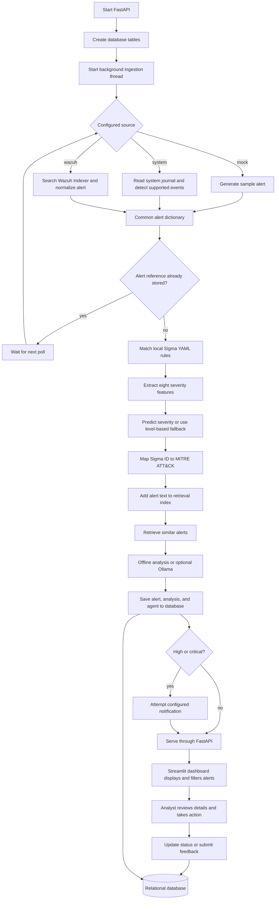

# Mentor Presentation Guide

## Project In One Minute

The AI SOC Analyst Assistant is a local security-alert triage platform. It accepts
alerts from mock data, Linux system logs, or a Wazuh manager. A FastAPI backend
enriches each alert with a Sigma rule match, a severity prediction, a MITRE
ATT&CK mapping, and an AI-assisted summary with remediation suggestions. The
enriched record is saved in a relational database and reviewed through a
Streamlit dashboard. An analyst remains responsible for acknowledging,
escalating, or correcting the alert.

The goal is to reduce repetitive first-pass triage, not to replace a SOC analyst
or to claim that an alert is certainly malicious.

## End-to-End Workflow



### What Happens At Each Stage

1. **Startup:** `backend/app/main.py` initializes database tables, starts the
   background ingestion loop, and stops that loop when the API shuts down.
2. **Choose an input:** `INGESTION_MODE` selects `mock`, `system`, or `wazuh`.
   Mock mode is the easiest demonstration path. System mode checks supported
   local journal events. Wazuh mode searches the configured Wazuh Indexer. All three
   eventually call the shared alert-processing function.
3. **Normalize and deduplicate:** source data is represented as a common alert
   dictionary. Wazuh data is explicitly normalized in `normalize_wazuh_alert()`;
   system and mock sources produce their own dictionaries. Existing
   `alert_ref` values are skipped to avoid storing the same alert twice.
4. **Match a detection rule:** the Sigma engine loads YAML files from
   `backend/sigma_rules/` and its `auto/` directory. It checks supported
   selectors against alert text and fields and returns the first matching rule.
   This project implements a lightweight subset of Sigma, not the complete
   upstream Sigma specification. Current validation confirms that samples match
   a rule, but overlapping selectors can make the first match unrelated to the
   sample's intended rule; match coverage is not detection precision.
5. **Estimate severity:** `features.py` extracts eight numeric inputs: Wazuh
   level, Sigma severity hint, agent OS type, hour, day, script indicator, a
   log-size proxy, and a previous-alert count. `ml_predictor.py` uses the saved
   classifier when available. If there is no usable model, it maps Wazuh level
   to severity as a fallback.
6. **Add threat context:** `mitre_mapper.py` uses a local mapping from Sigma rule
   IDs to ATT&CK tactics and techniques, with a few description/log heuristics
   when no rule ID is mapped.
7. **Retrieve and analyze:** the RAG engine indexes the current alert text and
   retrieves similar indexed alerts. The default implementation uses TF-IDF;
   sentence-transformers can provide semantic embeddings when installed. The
   LLM client uses offline analysis by default or can call a local Ollama model.
   The resulting summary, technique text, remediation, model name, and sources
   are attached to the alert. Since indexing happens before retrieval, the
   current alert may appear among its own similar results.
8. **Persist and notify:** the alert and agent record are committed to the
   relational database. High and critical predictions trigger a notification
   attempt; delivery depends on notification configuration.
9. **Review and respond:** the dashboard calls FastAPI endpoints to list and
   filter alerts, display details and statistics, submit chat questions, update
   status, and record analyst feedback. Feedback is stored, but this code does
   not automatically retrain the model from it.

## Component Map

| Component | Main location | What it does and how it is used |
|---|---|---|
| Configuration | `backend/app/config.py`, `.env` | Selects database URL, ingestion mode, model path, LLM mode, API URLs, polling intervals, and notification settings. Defaults make a local mock/offline run possible. |
| FastAPI application | `backend/app/main.py` | Registers routers, initializes storage on startup, and controls the ingestion thread lifecycle. Provides the backend REST interface and API documentation. |
| Ingestion and processing | `backend/app/ingester.py` | Polls or generates source events, normalizes Wazuh alerts, avoids duplicate references, calls the enrichment stages, persists results, and attempts notifications for high/critical alerts. |
| Mock data | `backend/app/mock_data.py` | Supplies repeatable security-alert templates so the pipeline and UI can be exercised without a SIEM. |
| System log input | `backend/app/system_logs.py` | Reads local system events and identifies a limited set of supported event patterns when system mode is selected. |
| Wazuh client | `WazuhIndexerClient` in `backend/app/ingester.py` | Searches recent documents in the `wazuh-alerts-*` index over the Indexer REST API when Wazuh mode is selected. Requires a reachable Indexer and valid Indexer credentials. |
| Sigma rules | `backend/app/sigma_engine.py`, `backend/sigma_rules/` | Loads local YAML detection rules and matches alert text/fields. The engine returns its first matching rule. `scripts/generate_sigma_rules.py` is a separate tool for producing additional rule files. |
| Feature extraction and severity | `backend/app/features.py`, `backend/app/ml_predictor.py` | Converts alert attributes to eight numeric features and predicts low/medium/high/critical severity. A Wazuh-level mapping is used if a model file is missing or prediction fails. |
| Model training | `scripts/train_model.py`, `data/results/` | Generates synthetic examples from alert templates, trains XGBoost if installed or otherwise Random Forest, evaluates a held-out split, writes a model/report files, and records model metadata. |
| MITRE mapping | `backend/app/mitre_mapper.py` | Maps known Sigma IDs to local ATT&CK tactic/technique data and uses simple text heuristics as a fallback. It is not a live ATT&CK feed integration. |
| RAG retrieval | `backend/app/rag_engine.py` | Keeps alert text in an in-process retrieval index and finds similar alerts using TF-IDF or optional sentence-transformer embeddings. It supplies context to analysis and chat. |
| LLM analysis | `backend/app/llm_client.py` | Produces alert summaries and remediation guidance in offline mode or by calling a configured local Ollama model. Output is analyst assistance, not authoritative incident disposition. |
| Relational storage | `backend/app/database.py`, `backend/app/models.py` | SQLAlchemy supports SQLite by default and PostgreSQL by configuration. Tables represent alerts, agents, feedback, Sigma-rule records, and model metadata. |
| Alerts API | `backend/app/routers/alerts.py` | Lists, searches, filters, and returns alert details; allows status updates such as acknowledged, escalated, or false positive. |
| Chat, stats, feedback APIs | `backend/app/routers/chat.py`, `stats.py`, `feedback.py` | Supports SOC questions with optional alert context, dashboard statistics/model information, and analyst feedback records. |
| Other capability APIs | `backend/app/routers/enhancements.py` and related modules | Exposes threat-intelligence lookup, training scenarios, compliance report generation, and incident-response actions. These are auxiliary API capabilities, not required steps in the main alert-enrichment path. The incident-response route requests dry-run behavior. |
| Analyst dashboard | `frontend/dashboard.py`, `frontend/utils.py` | Streamlit user interface. It calls the backend over HTTP; it does not independently run alert ingestion or enrichment. |
| Setup and testing tools | `scripts/`, `tests/` | Seed the database, inject test alerts, capture examples, generate rules, train the model, and verify backend/Sigma behavior. |

## Four-Person Presentation: 20 Minutes

Aim for about five minutes per speaker. The planned talk is 20 minutes before
questions, so it clears a 15-minute minimum without needing to rush. Replace the
speaker labels with team members' names and rehearse the handoffs once.

### Speaker 1: Problem, Purpose, and Architecture (0:00-5:00)

**0:00-1:00 | Opening**

> “Our project is the AI SOC Analyst Assistant. A SOC analyst receives many
> security alerts and must decide which need attention first. Our system
> automates parts of the first-pass triage: it collects an alert, adds detection
> and threat context, estimates severity, and presents the result for human
> review.”

**1:00-2:00 | Scope**

> “This is an analyst-assistance and learning prototype. It does not prove that
> an attack happened, and it does not replace human investigation. The analyst
> remains in control of acknowledging, escalating, and marking false positives.”

**2:00-4:00 | Architecture**

Point to the flowchart and introduce the three practical layers:

> “The input layer has three selectable sources: mock alerts, supported local
> system events, and Wazuh. The processing layer is a FastAPI backend that runs
> one shared enrichment function. The review layer is a Streamlit dashboard
> that calls the backend REST API. A relational database stores alerts and
> analyst actions.”

**4:00-5:00 | Startup and configuration**

> “When FastAPI starts, it creates the database tables and starts a background
> ingestion thread. The `.env` configuration selects the input mode, database,
> model, and LLM option. For a simple demonstration, mock ingestion and offline
> analysis avoid external services.”

**Handoff to Speaker 2:**

> “Now that we have the system map, [Name] will follow one alert from its source
> through detection and severity scoring.”

### Speaker 2: Ingestion, Sigma, and Severity (5:00-10:00)

**5:00-6:30 | Source and normalization**

> “The ingestion loop selects one source based on configuration. Wazuh results
> are converted by `normalize_wazuh_alert()` into the fields used by the rest of
> the pipeline. Mock and system sources produce the same general kind of alert
> record. The processor checks the alert reference so an already stored alert
> is not processed again.”

**6:30-8:00 | Sigma detection**

> “The Sigma engine loads YAML files from the rules folder, including the auto
> subfolder. It checks supported selectors against fields and alert text. When
> a rule matches, the rule ID and title become part of the alert. Our engine is
> a practical subset of Sigma, so we should not describe it as a full Sigma
> implementation.”

**8:00-10:00 | ML severity**

> “After rule matching, feature extraction creates eight numeric values, such
> as Wazuh level, Sigma severity, operating system, time, script indicators, and
> log-size proxy. The saved model predicts low, medium, high, or critical. If
> the model file is unavailable or prediction fails, a deterministic Wazuh-level
> mapping keeps the pipeline running.”

Mention training honestly:

> “The training script creates synthetic examples from our templates. Because
> the training labels are derived from Wazuh level and Wazuh level is also an
> input, there is target leakage. So an accuracy result measures how well the
> model reproduces that mapping on our generated test split; it is not evidence
> of general detection accuracy on real attacks.”

**Handoff to Speaker 3:**

> “Severity helps prioritize the queue. [Name] will explain how the alert gets
> threat-framework context and how the natural-language analysis is produced.”

### Speaker 3: MITRE, RAG, LLM, and Supporting Capabilities (10:00-15:00)

**10:00-11:15 | MITRE ATT&CK**

> “The mapper uses the Sigma rule ID to look up a local ATT&CK tactic, technique,
> and kill-chain phase. A few basic text heuristics are available when a rule
> mapping is missing. This makes the result more standardized, but it is a
> local mapping rather than a live threat-intelligence feed.”

**11:15-13:15 | RAG and LLM**

> “The retrieval component adds the current alert text to an in-memory index and
> searches for similar alert text. TF-IDF is the lightweight default; optional
> sentence-transformer embeddings provide semantic similarity. The retrieved
> context is passed to the analysis client. Offline mode uses local templates
> and rules, while Ollama mode can call a local model. The resulting text is a
> triage aid and must be checked by an analyst.”

**13:15-14:15 | Auxiliary features**

> “There are additional API capabilities for training scenarios, threat-intel
> lookup, compliance reports, and incident response. They are separate from the
> mandatory alert-processing path. The incident-response endpoint is configured
> for dry-run behavior, so we should present it as a controlled capability,
> not claim that the current demo automatically contains an endpoint.”

**14:15-15:00 | Storage and notification**

> “The completed record, agent information, severity, MITRE mapping, and AI
> fields are saved in SQLite by default, with PostgreSQL supported through
> configuration. High and critical predictions can trigger notifications if
> notification services are configured.”

**Handoff to Speaker 4:**

> “The enrichment result is useful only if an analyst can review and act on it.
> [Name] will show the dashboard workflow and close with the project’s limits
> and next steps.”

### Speaker 4: Dashboard, Analyst Workflow, Demo, and Next Steps (15:00-20:00)

**15:00-16:30 | Dashboard and API**

> “The Streamlit dashboard calls FastAPI over HTTP. The API returns alert lists,
> details, statistics, and model information. An analyst can filter alerts,
> inspect the Sigma and MITRE fields, review the severity and AI guidance, and
> update the status.”

**16:30-18:00 | Analyst feedback**

> “The analyst can submit feedback such as whether severity was correct or
> whether the alert is a false positive. That feedback is stored and a false
> positive can update the alert status. The current code does not automatically
> retrain the model from feedback; retraining is a separate training-script
> operation.”

**18:00-19:15 | Short demonstration**

Use the live system if available; otherwise present a captured alert example.

1. Open the dashboard and point out the alert count and severity filters.
2. Open one alert and identify its source, Sigma rule, severity, MITRE mapping,
   summary, and remediation.
3. Ask the chat assistant a question about that alert or the alert counts.
4. Change the alert status or submit feedback.
5. Explain that each displayed result comes from the backend API and stored
   alert data.

**19:15-20:00 | Limitations and close**

> “The key limitations are synthetic training data, target leakage in severity
> labels, a lightweight subset of Sigma, local heuristic ATT&CK mappings, and
> generated analysis that can be wrong. Our next steps would be to test on
> independently analyst-labeled alerts, measure false positives and missed
> detections, improve rule coverage, and validate response actions in a
> controlled environment. The contribution today is an integrated, locally
> runnable triage workflow with visible human review.”

## Live Demo Preparation

Start in the project directory. Use a prepared virtual environment and install
the project requirements before presentation day.

```bash
./venv/bin/python -m scripts.train_model --samples 2000
./venv/bin/python -m scripts.seed_data --count 30
./venv/bin/uvicorn backend.app.main:app --host 127.0.0.1 --port 8000
```

In another terminal:

```bash
./venv/bin/streamlit run frontend/dashboard.py
```

Open `http://localhost:8501` for the dashboard and `http://localhost:8000/docs`
for interactive API documentation. Confirm `.env` uses `INGESTION_MODE=mock`
and `LLM_MODE=offline` for a demo that does not depend on Wazuh or Ollama. Avoid
retraining during the talk; prepare the model and sample alerts in advance.

## Likely Mentor Questions

**Does a critical result mean an attack is confirmed?**

No. It is a severity estimate used to prioritize review. Detection and final
incident disposition require investigation.

**Is the ML accuracy proof of production performance?**

No. The model is trained on generated template data, and the target is derived
from Wazuh level, which is also a feature. This introduces target leakage. A
production evaluation needs independently labeled real alerts and appropriate
false-positive and false-negative measurements.

**Does analyst feedback automatically improve the model?**

No. Feedback is saved in the database. Model training is an explicit script
operation; an automated retraining and validation workflow is not implemented.

**Is the RAG index a persistent vector database?**

The current `RAGEngine` stores documents and vectors in process memory and uses
TF-IDF by default or optional sentence-transformer embeddings. Although a vector
store directory is configured, this engine does not persist its index to
ChromaDB. Restarting the backend therefore resets the in-memory retrieval data.

**Does a 100% Sigma match rate mean every alert maps to the correct rule?**

No. Validation checks whether some rule matched. Overlapping selectors can make
the first match differ from the alert template's intended rule. Evaluation
should measure per-rule precision and false positives, not only match coverage.

**Does the project block attackers automatically?**

The core workflow enriches and presents alerts. The incident-response API
currently requests dry-run behavior; do not claim production containment or
automatic blocking.

**What is the simplest way to reproduce the demo?**

Train the model, seed a small set of alerts, run FastAPI and Streamlit in
separate terminals, and use mock ingestion with offline analysis.

## Reference Implementation Files

- Application startup and router registration: `backend/app/main.py`
- Ingestion and enrichment orchestration: `backend/app/ingester.py`
- Model features and inference: `backend/app/features.py`, `backend/app/ml_predictor.py`
- Retrieval and LLM: `backend/app/rag_engine.py`, `backend/app/llm_client.py`
- Data schema and database setup: `backend/app/models.py`, `backend/app/database.py`
- Dashboard and HTTP helpers: `frontend/dashboard.py`, `frontend/utils.py`