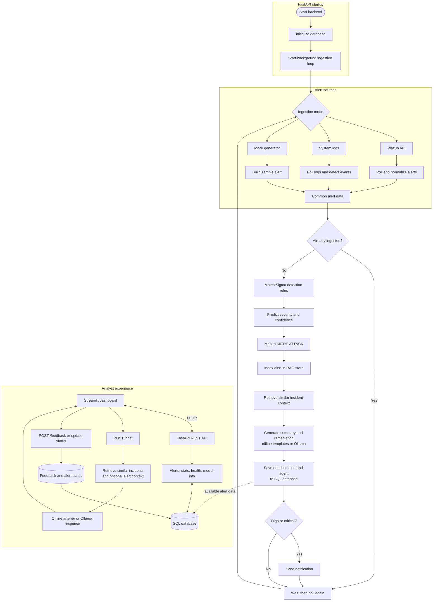

# Project Flow Chart

The backend starts ingestion when FastAPI starts. Mock, system-log, and Wazuh
ingestion converge on the same enrichment pipeline; analysts then review and
update alerts through the dashboard and REST API. The LLM and Wazuh integrations
are optional, depending on configuration.